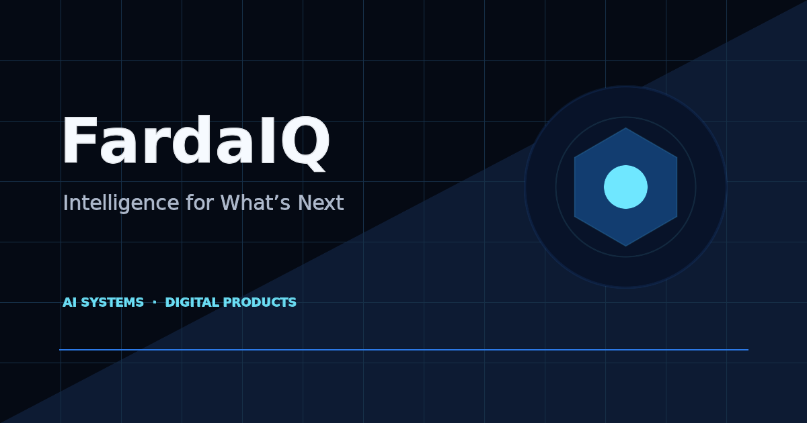
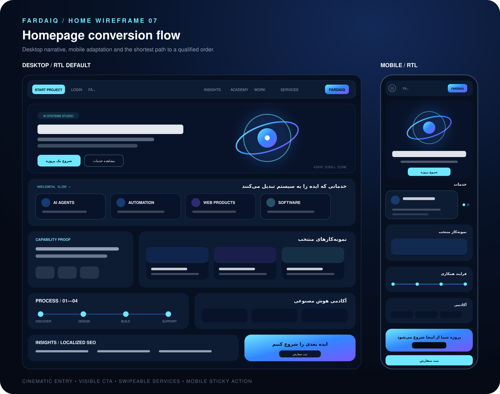
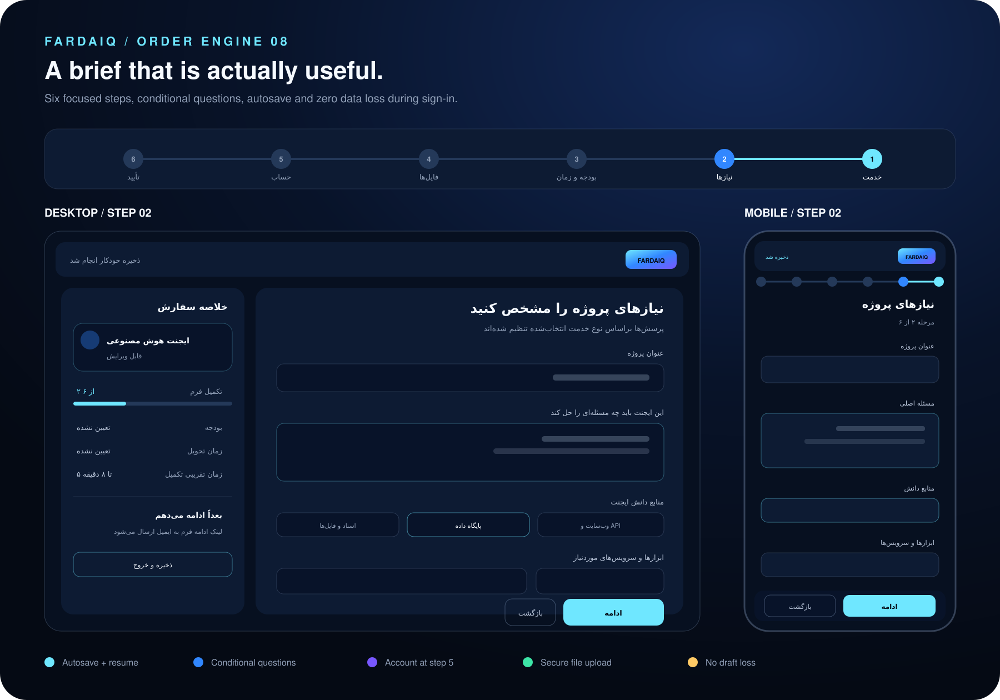
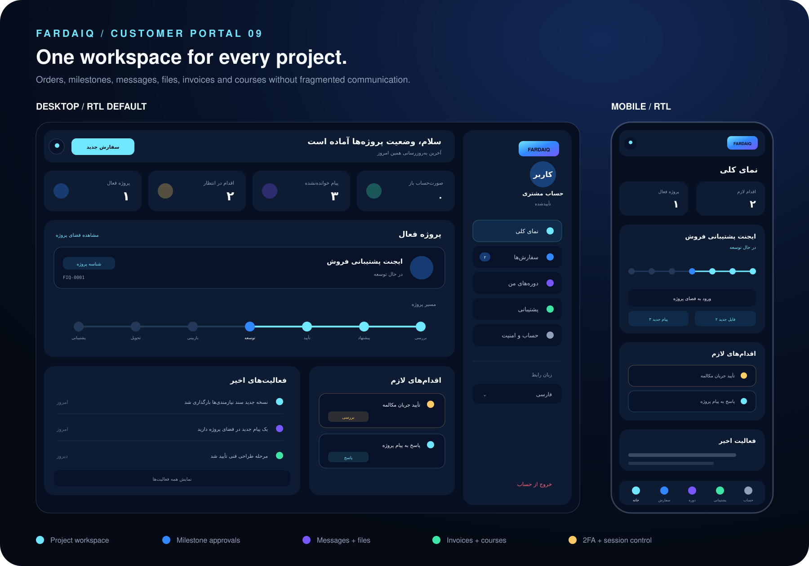
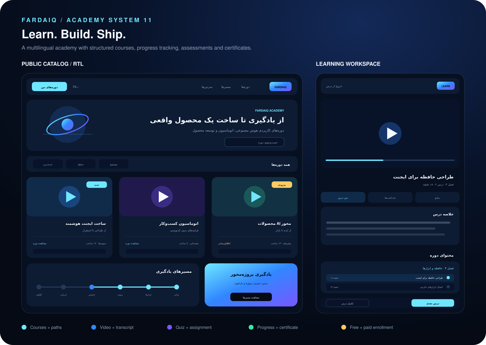

# FardaIQ — Multilingual AI Services Platform

FardaIQ is a production-oriented, multilingual platform for presenting and ordering AI, automation, web, and software services. It combines a public marketing website, a guided project-ordering flow, a customer workspace, an academy, and an operations layer in one coherent product.

> **Portfolio showcase:** The complete production source code is maintained in a private repository. This public repository contains only presentation material, selected product visuals, and a high-level technical case study. No customer data, credentials, database schema, private API contract, or proprietary business logic is included.

## Product overview

- Multilingual experience for Persian, English, and German
- Native RTL/LTR layouts and localized SEO
- AI agents, automation, web products, and custom software services
- Six-step project brief with conditional questions and draft recovery
- Customer portal for orders, projects, milestones, messages, files, and approvals
- Academy with courses, learning paths, progress tracking, assessments, and certificates
- Administrative operations for projects, proposals, content, and course management
- Privacy, accessibility, auditability, and EU/Germany-readiness considerations

## Selected product views

### Responsive homepage and conversion flow

### Guided project-ordering experience

### Customer project workspace

### Integrated academy

## Engineering highlights

| Area | Implementation direction |
|---|---|
| Front end | React, Next.js-compatible routing, TypeScript, responsive RTL/LTR UI |
| Edge runtime | Cloudflare-oriented Vite/Vinext build and Workers deployment model |
| Data | Relational D1 persistence with Drizzle ORM and reviewed migrations |
| Files | Private object storage with controlled upload/download flows |
| Security | Server-side RBAC, CSRF protection, rate limiting, hardened sessions, audit events |
| Delivery | Pull requests, automated CI verification, dependency monitoring, deployment workflow |
| Quality | Linting, build validation, migration verification, and rendered-output tests |

## Documentation

- [Product case study](docs/case-study.md)
- [Architecture overview](docs/architecture-overview.md)
- [Security, privacy, and accessibility](docs/security-privacy-accessibility.md)
- [Delivery status and roadmap](docs/status-and-roadmap.md)

## Current status

- Private production repository: active
- CI on the main branch: passing
- Dependency and security monitoring: enabled
- Public showcase: available in this repository
- Production hosting and public live demo: planned next

## Ownership and contact

Designed and developed by **Erfan Bonyani**.

- GitHub: [ErfanBonyani](https://github.com/ErfanBonyani)
- Email: [erfan.bonyaniapp@gmail.com](mailto:erfan.bonyaniapp@gmail.com)

## Usage notice

This repository is a portfolio presentation, not an open-source distribution. All product designs, documentation, branding, and associated materials are proprietary. See [LICENSE.md](LICENSE.md).
