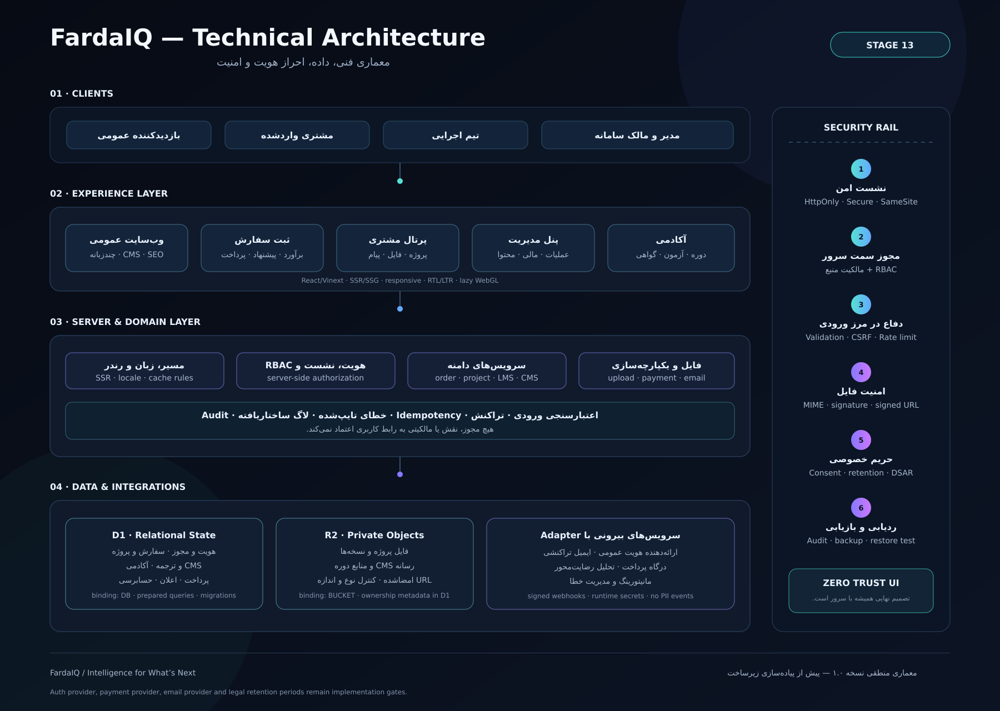

# Architecture overview

FardaIQ follows a layered architecture that separates public presentation, authenticated experiences, domain services, persistence, and integrations.

## Experience layer

- Public multilingual website
- Guided order flow
- Authenticated customer portal
- Administrative workspace
- Academy and certificate verification

## Server and domain layer

- Locale-aware routing and rendering
- Authentication, sessions, and role-based authorization
- Order, project, academy, and content domains
- File, payment, email, and external-provider adapters
- Structured validation and auditable state transitions

## Data and storage layer

- Relational state for identities, orders, projects, academy records, and audit history
- Private object storage for project files and course assets
- Migration-controlled schema evolution
- Backup and restore readiness

## Delivery model

Changes are developed on short-lived branches, validated through pull requests, and merged only after automated checks. The deployment workflow is designed to publish the verified main branch to the hosting environment once production credentials and infrastructure are configured.

This document intentionally omits internal database definitions, private API contracts, infrastructure identifiers, and security-sensitive implementation details.
