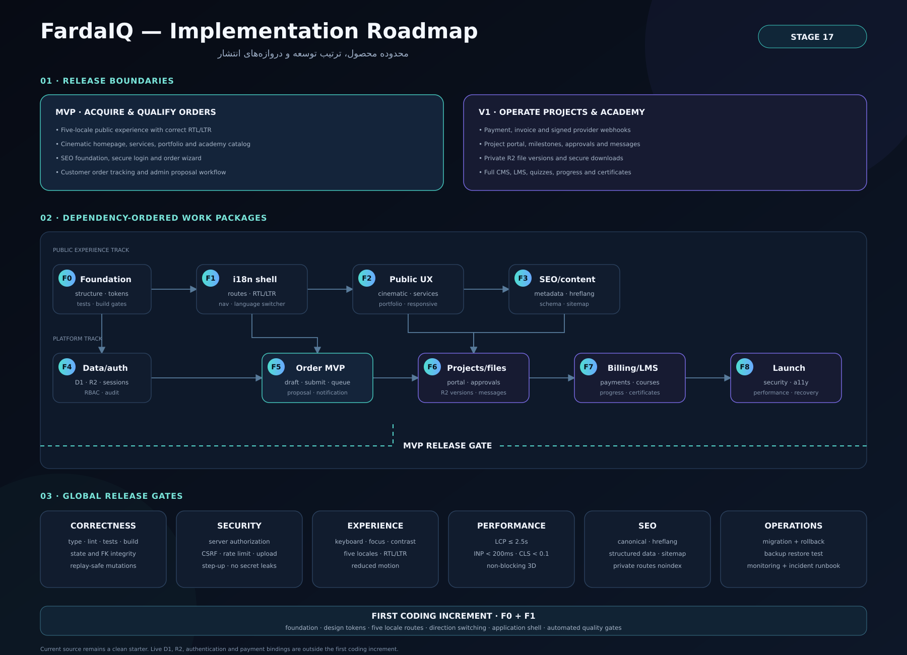

# Delivery status and roadmap

This roadmap separates the implemented and verified product foundation from hosting-dependent work that is not yet public.

## Completed foundation

- Multilingual Persian, English, and German experience
- Locale-aware routing and native RTL/LTR presentation
- Service catalogue and detail-page structure
- Conditional guided project-ordering workflow
- Customer portal and project workspace foundation
- Academy, progress, assessment, and certificate concepts
- Administrative operations foundation
- Relational data model and migration verification direction
- Security, privacy, accessibility, and SEO foundations
- Pull-request workflow, passing main-branch CI, and dependency monitoring
- Documentation-only public portfolio without proprietary source or secrets

## Current verified state

| Deliverable | Status |
|---|---|
| Private implementation repository | Active |
| Public employer-facing showcase | Available |
| Main-branch CI | Passing |
| Dependency and security monitoring | Enabled |
| Production deployment workflow | Prepared; hosting configuration pending |
| Public live URL | Not yet available |

## Next delivery milestone — public launch

1. Select and configure the production hosting environment.
2. Store deployment credentials as encrypted secrets rather than source files.
3. Deploy the verified main branch.
4. Configure the domain and TLS.
5. Connect the selected production email, payment, analytics, and consent services where required.
6. Run multilingual, authentication, authorization, file, performance, accessibility, and production smoke checks.
7. Replace wireframes with selected real product screenshots.
8. Add the live URL to the showcase, GitHub profile, and résumé.

## Future evolution

- Operational monitoring and analytics
- Additional AI-agent integrations
- Expanded course catalogue
- Customer-support automation
- Continued accessibility, performance, privacy, and security verification

## Scope note

Completion of the foundation does not imply that hosting-dependent services or external compliance review are finished. Production claims will be updated only after deployment and verification.

